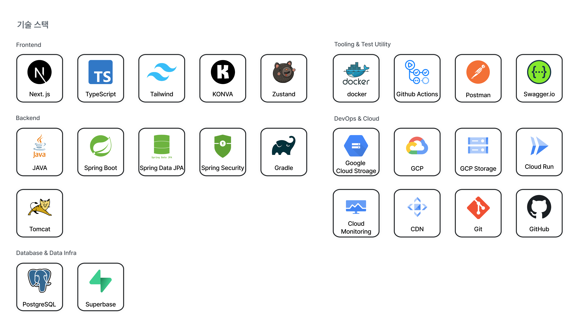
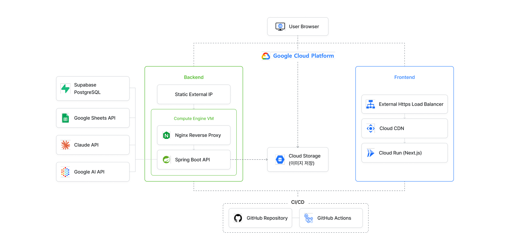

<div align="center">


`EDIT THE MOOD`

[](https://openjdk.org/projects/jdk/17/)
[](https://spring.io/projects/spring-boot)
[](https://spring.io/projects/spring-security)
[](https://www.postgresql.org/)
[](https://cloud.google.com/storage)
[](https://gradle.org/)

[🌐 서비스 데모](https://aven-studio.store/) · [🛠️ API 문서](https://api.aven-studio.store/swagger-ui/index.html) · [📑 발표 자료](https://drive.google.com/file/d/1r2HfghPLR_nrINm06LYq8mFMK5qMeubu/view?usp=drive_link)

</div>

<br />

## 프로젝트 소개

**MOODITOR**는 신한 스퀘어브릿지 청년 해커톤 3기(x Coolbears)에서 4인 팀 **씽킹(Thinking)** 이 6주간 기획부터 개발까지 진행한 프로젝트입니다.
친환경 패션테크 기업 쿨베어스의 스포츠웨어 브랜드 **에이븐(aven)** 을 대상으로, 온라인 쇼핑몰 운영자가 반복적으로 겪는 콘텐츠 제작 문제를 해결하기 위해 만들었습니다.

기업 인터뷰와 유저 리서치(온라인 의류 구매자 84명 설문)를 통해 확인한 핵심 문제는 **"AI로 이미지는 쉽게 만들 수 있어도, 브랜드다운 일관성은 유지하기 어렵다"** 는 점이었습니다. MOODITOR는 이 문제를 아래 3가지 방향으로 풀었습니다.

| 문제 | 해결 |
| --- | --- |
| 모델 섭외–촬영–편집까지 1~2개월이 걸리는 콘텐츠 제작 | AI 이미지 생성으로 다양한 콘텐츠를 빠르게 제작 |
| AI 결과물에 브랜드 아이덴티티가 일관적으로 반영되지 않음 | 브랜드 홈페이지·자료를 분석해 도출한 **브랜드 무드**를 모든 생성 과정에 반영 |
| 이미지 생성과 상세페이지 편집이 분리되어 반복 작업 발생 | 상품 연동 → 무드 분석 → 이미지 생성 → 상세페이지 제작을 하나의 워크플로우로 통합 |

> 이 레포지토리는 **백엔드**를 담당합니다. 인증·상품 연동·브랜드 무드 분석·이미지 생성·상세페이지·라이브러리 API와 데이터 모델을 Spring Boot로 구성했습니다.

<br />

## 핵심 기능

### 1. JWT 기반 인증

회원가입·로그인·토큰 재발급·로그아웃 흐름을 제공합니다. Access Token과 Refresh Token을 `HttpOnly` 쿠키로 전달하고, Refresh Token은 PostgreSQL에 사용자별로 보관해 세션 재발급과 폐기를 관리합니다.

### 2. Google Sheets 상품 연동

Google Sheets를 브랜드에 연결해 상품 데이터를 동기화합니다. 연동된 상품은 카테고리·색상·성별·키워드 조건으로 검색할 수 있고, 페이징·정렬 메타데이터와 함께 응답합니다.

### 3. 브랜드 무드 분석

브랜드 URL과 선택 PDF를 분석해 브랜드 요약, 디자인 철학, 톤, 색온도, 채도, 대비, 조명, 질감, 배경, 구도를 구조화합니다. 사용자가 확인·수정한 분석 결과를 버전별로 저장해 이후 이미지 생성에 일관되게 반영합니다.

### 4. AI 이미지 생성

모델컷·제품컷 생성 작업을 비동기로 요청하고, Job ID를 기준으로 진행 상태와 결과를 조회합니다. 색온도·카메라 각도·프레이밍·비율·생성 수량과 컷 템플릿, 모델·배경·포즈 레퍼런스를 구조화해 제공합니다.

### 5. 상세페이지 AI 자동화

상세페이지 편집에 필요한 상품·에셋 초기 데이터를 제공하고, 템플릿 이미지 자동 배치·문구 생성·통합 자동 채우기·AI 문구 검수를 처리합니다. 완성된 상세페이지 이미지는 GCS와 라이브러리에 저장합니다.

### 6. 에셋·라이브러리 관리

`jpg`, `png`, `webp` 이미지를 상품 단위 경로로 GCS에 저장하고 메타데이터를 DB에 기록합니다. 상품별 생성 이미지와 상세페이지를 조회·좋아요·삭제할 수 있으며, 조회 시 제한 시간 동안 유효한 GCS Signed URL을 발급합니다.

<br />

## 기술적으로 신경 쓴 부분

백엔드에서 마주친 문제와 해결 방식 위주로 정리했습니다.

<details>
<summary><b>Stateless JWT 인증과 Refresh Token 폐기</b></summary>
<br />

서버 세션을 사용하지 않는 `STATELESS` 구조에서도 로그아웃과 Refresh Token 무효화가 가능해야 했습니다. Access Token은 매 요청마다 필터에서 검증하고, Refresh Token은 사용자당 하나만 DB에 보관하도록 구성했습니다. 재로그인 시 토큰을 갱신하고 로그아웃 시 저장된 토큰을 삭제해 재사용을 막습니다.

</details>

<details>
<summary><b>선택적 필터 조합과 페이징</b></summary>
<br />

상품 검색은 네 개의 필터가 독립적으로 생략될 수 있어 경우의 수가 많습니다. 입력값을 정규화한 뒤 카테고리 유무에 따라 쿼리를 나누고, `Pageable`과 JPQL 조건식으로 필터 조합을 처리했습니다. 또한 `하의`를 `바지·치마`로, `악세서리`를 `모자·가방`으로 확장해 UI 카테고리와 저장 데이터 간의 차이를 해소했습니다.

</details>

<details>
<summary><b>레퍼런스 이미지가 결과물에 섞이는 문제</b></summary>
<br />

모델·상품·포즈·배경·촬영 구도 이미지를 함께 전달했을 때, AI가 구도 참고 이미지의 모델 외형이나 상품까지 최종 결과에 반영하는 문제가 있었습니다. 모든 이미지를 동일한 레퍼런스로 취급해 AI가 각 에셋의 역할을 구분하지 못한 것이 원인이었습니다.

상품 에셋은 `assetRole`의 `PRODUCT_FRONT`·`PRODUCT_BACK`으로, 생성 레퍼런스는 `MODEL`·`POSE`·`BACKGROUND`·`SHOT_REFERENCE` 유형으로 역할을 분리했습니다. 모델컷과 제품컷의 프롬프트 조립 로직도 독립시켰습니다. 상품 이미지는 색상·로고·소재 보존에 가장 높은 우선순위를 두고, 포즈와 샷 레퍼런스는 외형이 아닌 자세와 카메라 구도만 참고하도록 명시했습니다. 이를 통해 상품과 모델의 정체성을 유지하면서 선택한 포즈와 구도만 결과에 반영하도록 개선했습니다.

</details>

<details>
<summary><b>GCS와 DB 간 업로드 일관성</b></summary>
<br />

파일은 GCS에 저장되지만 메타데이터는 PostgreSQL에 저장되기 때문에, DB 저장 실패 시 고아 객체가 남을 수 있습니다. 업로드 중 예외가 발생하면 해당 요청에서 이미 생성한 GCS 객체를 보상 삭제하고, 트랜잭션을 롤백하도록 구성했습니다.

</details>

<details>
<summary><b>비동기 이미지 생성과 병렬 작업 제어</b></summary>
<br />

이미지 생성은 응답 시간이 길고 한 번에 여러 장을 요청할 수 있어 일반 HTTP 요청으로 처리하기 어렵습니다. 생성 요청을 Job으로 저장한 뒤 작업·태스크 전용 Executor에서 처리하고, 결과별 진행 상태를 누적해 폴링 API로 조회하도록 구성했습니다. 일시적인 Google AI 오류는 재시도하고, 한도를 넘은 요청은 유한 큐에서 거절해 서버 자원을 보호합니다.

</details>

<details>
<summary><b>AI 자동 채우기의 부분 실패 처리</b></summary>
<br />

상세페이지 자동 채우기는 이미지 배치와 문구 생성이 서로 다른 AI 처리 단계입니다. 문구 생성이 실패해도 성공한 이미지 배치를 버리지 않고 `PARTIAL_SUCCESS`와 재시도 가능 여부를 응답합니다. 이미지 배치 결과가 비어 있을 때는 deterministic fallback으로 빈 슬롯을 보완해 AI 의존 구간의 부분 장애가 전체 작업 실패로 번지지 않도록 했습니다.

</details>

<details>
<summary><b>일관된 예외 응답</b></summary>
<br />

인증 실패, 중복 아이디, 잘못된 카테고리·성별 등 도메인 예외를 분리했습니다. `GlobalExceptionHandler`가 예외를 공통 `ErrorResponse`로 변환해, 클라이언트가 항상 동일한 형태로 오류를 처리할 수 있도록 했습니다.

</details>

<br />

## API

**Base URL** `https://api.aven-studio.store`

| Domain | Representative Endpoints | Description |
| --- | --- | --- |
| Auth | `/auth/*` | 회원가입, 로그인, 토큰 재발급, 로그아웃 |
| Sheets | `/sheets` | Google Sheets 연결·동기화 |
| Products | `/products` | 상품 검색·필터·페이징 |
| Brands | `/brands/me/moods/*` | 브랜드 무드 분석·저장·조회 |
| Assets | `/assets/*` | 상품 이미지 업로드·조회·삭제 |
| Image Generation | `/image-generation/*` | 생성 Job 요청·상태 조회·옵션·레퍼런스 |
| Detail Page | `/detail-pages/*` | 초기 데이터, 자동 배치, 문구 생성·검수, 저장 |
| Library | `/library/*` | 상품별 이미지·상세페이지, 좋아요·삭제 |

인증이 필요한 API는 로그인 시 발급되는 `accessToken` HttpOnly 쿠키를 사용합니다. 전체 요청·응답 스키마와 실행 가능한 명세는 [Swagger UI](https://api.aven-studio.store/swagger-ui/index.html)에서 확인할 수 있습니다.

<br />

## 기술 스택

<div align="center">

</div>

<br />

**Core**

`Java 17` · `Spring Boot 4.1` · `Gradle`

**Data**

`Spring Data JPA` · `Hibernate` · `PostgreSQL` · `Supabase` · `Caffeine`

**Security**

`Spring Security` · `JWT` · `BCrypt`

**AI / Integration**

`Google Gemini` · `Anthropic Claude` · `Google Sheets API` · `Spring WebClient`

**Storage / Docs / Infra**

`Google Cloud Storage` · `Springdoc OpenAPI` · `GitHub Actions` · `GCP VM`

<br />

## 아키텍처

<div align="center">

</div>

<br />

## 폴더 구조

```text
src/main/java/kr/co/daeun/avenstudiobe/
├─ domain/
│  ├─ auth/               # JWT 인증·인가, Refresh Token
│  ├─ user/               # 회원가입, 사용자
│  ├─ brand/              # 브랜드
│  ├─ brandmood/          # 브랜드 무드 분석·저장
│  ├─ product/            # 상품 검색·페이징
│  ├─ asset/              # 상품 이미지 에셋
│  ├─ imagegeneration/    # 비동기 AI 이미지 생성
│  ├─ detailpage/         # 자동 배치·문구 생성·검수
│  ├─ library/            # 이미지·상세페이지 라이브러리
│  └─ sheet/              # Google Sheets 연동·동기화
├─ global/
   ├─ ai/                 # Claude 공통 클라이언트
   ├─ common/             # 공통 DTO
   ├─ config/             # Security, PasswordEncoder 설정
   ├─ exception/          # 전역 예외 처리
   └─ storage/            # Google Cloud Storage
└─ integration/
   ├─ anthropic/          # 브랜드 무드 AI 분석
   └─ google/             # Gemini 이미지 생성

src/main/resources/
└─ application.yml        # 애플리케이션 설정

docs/sql/
└─ supabase_schema.sql    # PostgreSQL 스키마·인덱스·초기 데이터
```

<br />

## Getting Started

### 1. 실행 환경

- JDK 17
- PostgreSQL
- Google Cloud Application Default Credentials

### 2. 데이터베이스 준비

PostgreSQL 데이터베이스에 [`docs/sql/supabase_schema.sql`](docs/sql/supabase_schema.sql)을 실행합니다. JPA가 `ddl-auto: validate`로 동작하므로 애플리케이션 실행 전 스키마가 생성되어 있어야 합니다. 기본 DataSource URL은 프로젝트 Supabase에 맞춰져 있으며, 다른 PostgreSQL을 사용하려면 `application.yml`의 `spring.datasource.url`을 해당 주소로 변경해야 합니다.

### 3. 환경 변수

```bash
export DB_USERNAME=<PostgreSQL 사용자>
export DB_PASSWORD=<PostgreSQL 비밀번호>
export JWT_SECRET=<32바이트 이상의 JWT 서명 키>
export GOOGLE_AI_API_KEY=<Gemini API 키>
export ANTHROPIC_API_KEY=<Claude API 키>
export GOOGLE_SHEETS_ENABLED=false
```

GCS 기능을 사용하려면 `aven-studio-assets` 버킷에 접근할 수 있는 Google Cloud 인증 정보도 필요합니다.

### 4. 실행

```bash
./gradlew bootRun
```

기본 서버 주소는 `http://localhost:8080`입니다.

### 5. 테스트

```bash
./gradlew test
```

<br />

## Team 씽킹 (Thinking)

신한 스퀘어브릿지 청년 해커톤 3기 x Coolbears

| Frontend | Backend | Backend | UX/UI Design |
| :---: | :---: | :---: | :---: |
| 강은우 | 김형주 | 이다은 | 김유희 |

- **김형주 (Backend)** — Image Generation, Brands, Assets, Library 
- **이다은 (Backend)** — Auth, Products, Sheets, Detail Page, Library 
